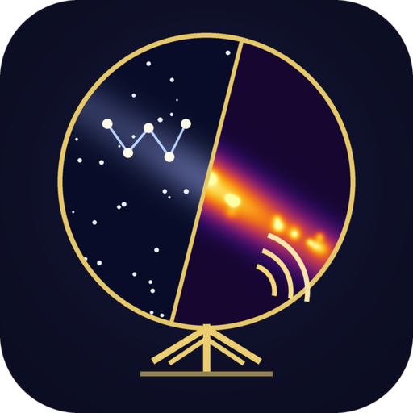

<p align="center"></p>

# Radio Sky

*The sky above you right now, as seen by a radio eye from 10 MHz to 94 GHz* — original Italian name: «Cielo radio»

Shows the sky above your location now, either as the naked eye sees it or as a radio telescope would, with a frequency slider from 10 MHz to 94 GHz. The radio sky comes from the GSM2008 and LFSM sky models, read directly from the pygdsm data files with h5py (no pygdsm, astropy or scipy needed). Positions of the Sun, Moon and planets are computed by hand (≤ 0.08° from astropy).

## Features

* Dome or panorama view, constellations, 18 famous radio sources, the Sun (NOAA RSTN flux) and the Moon painted into the model
* SkyView cut-outs, accelerated time, PNG and MP4 export (12 hours or a sweep through all frequencies)
* **LWA TV live** with *Compare*: the model as seen by the LWA1 station next to the real all-sky image

> **Language note.** The interface is in **Italian** (large, adjustable text); plots, PDF/PNG cards and scientific output are in **English**. Code comments are in Italian. The original Italian guide is [`LEGGIMI.txt`](LEGGIMI.txt).

**Version:** 1.0 (2026-11-20). **Status:** 1.0 built, self-test passed with the real GSM2008.

## Quick start

Requirements: Python 3.10+ (tested with Python 3.14 on Ubuntu) with `tkinter` (Ubuntu: `sudo apt install python3-tk`).

```bash
git clone https://github.com/EDOKILLER/radio-sky.git
cd radio-sky
python3 -m pip install -r requirements.txt

python3 cielo_radio.py --autotest
python3 cielo_radio.py        # opens the window
```

### Standalone executable

`bash crea_eseguibile_ubuntu.sh` builds a single-file executable with PyInstaller in a temporary virtual environment, runs the self-test, and adds the program with its icon to the application menu and the desktop (first time on GNOME: right-click → *Allow launching*).

The build scripts were written for the author's machine: check the paths at the top before running them.

The default observing site is Padua (Italy): change it in the program's settings.

## Data sources and acknowledgements

Data are downloaded at run time from public services. If you publish results, please follow their acknowledgement policies:

* [pygdsm sky-model data files on Zenodo (GSM2008, GSM2016, LFSM)](https://zenodo.org/records/3835582)
* [Long Wavelength Array (LWA TV all-sky images)](https://lwalab.phys.unm.edu/)
* [NOAA Space Weather Prediction Center (GOES flares, RSTN radio flux)](https://www.swpc.noaa.gov/)
* [NASA/GSFC SkyView virtual observatory](https://skyview.gsfc.nasa.gov/)

This project is independent and not endorsed by any of these institutions.

## License

Code: [BSD 3-Clause](LICENSE) © 2026 Edoardo Battistel. You can use, modify and redistribute it, also commercially, as long as you keep the copyright notice; the author's name may not be used to promote derived works without permission. If you use it in research, see [`CITATION.cff`](CITATION.cff).

---
Part of a series of astronomy programs by Edoardo Battistel — see also [X-rays from Black Holes](https://github.com/EDOKILLER/x-rays-from-black-holes) and the other repositories on [this profile](https://github.com/EDOKILLER?tab=repositories).
